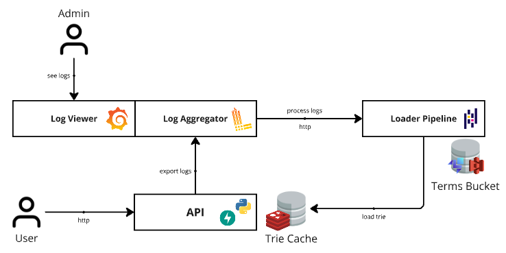

# Proof of Concept - Using Trie Trees on ranking terms by relevance

## Introduction

A proof of concept of a system capable of searching for terms and rank by relevance using trie trees based on the implementation described by Alex Xu, in the book [System Design Interview - An Insiders Guide](https://www.amazon.com.br/System-Design-Interview-insiders-Second/dp/B08CMF2CQF)

The trie is stored the way the book suggests for a key-value store: flattened, where each prefix (a node of the trie) is a key and its value is the list of the most searched terms below it. There is no tree object in the code: the pipeline builds this table directly from the terms file, and a search is a single read by prefix.

## Archtecture

### Components

1. A Python API, which exposes the endpoints to search for terms
2. Instrumentation with the Grafana stack for aggregation and visualization of logs
3. A Pipeline implemented with Pandas, which will process logs and is implemented together with the API, for simplicity
4. An S3 Storage, implemented with LocalStack, to archive the terms and search frequency
5. A Redis, to cache the most searched terms of every prefix, so a search is a single read.

### Happy Path

1. The API generates logs related to the terms searched by users;
2. These logs are exported to Grafana, where they will be aggregated and can even be visualized;
3. The API triggers the pipeline through an endpoint, which will request the logs from Grafana and will process them to update the terms file in S3.
4. Once the file is updated in S3, the most searched terms of every prefix are computed and saved in Redis, where they can be retrieved ranked by the number of searchs in step 1.

